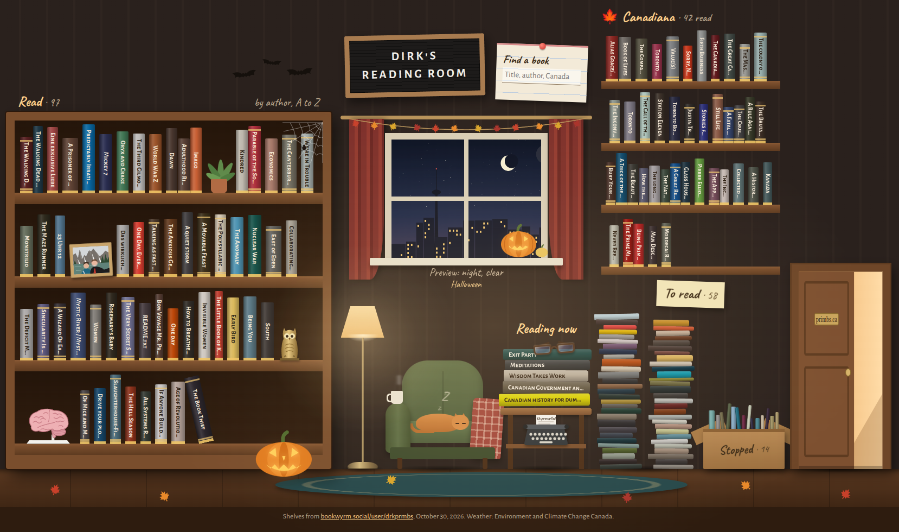

# Reading room

Live at https://primbs.ca/reading-room/

A cozy-living-room page of Dirk's BookWyrm shelves (bookwyrm.social/user/drkprmbs): a bookcase of read books (newest first, or by author or colour), read Canadian books on a wall shelf, the current books on a side table, to-read piles and a box of stopped books, with star ratings, reviews and finish dates on hover.

## How it's built

`build.py` fetches the public shelf pages and the ActivityPub outbox (ratings, reviews, "finished reading" dates) into `downloads/`, merges them, and fills `template.html` with the data. The result is one self-contained `index.html`, plus a `fonts/` folder when `--self-host-fonts` is set. No server-side code; the page can't update itself because BookWyrm doesn't allow cross-site requests.

A book counts as read when it is on the Read shelf or has a finish date (from the "finished reading" posts in the outbox), unless it is currently on Reading, To read or Stopped. A finished book wins over another edition of it on To read. Canadiana is a topic label only.

Everything comes from live, public BookWyrm data; nothing else is read. A read book that sits on no shelf and has no finish date can't be seen, so put it on the Read shelf.

Book descriptions come from BookWyrm too: the edition's, else the work's, else another edition's (about two thirds of the books have one). Book records are cached in `downloads/books/`; only new books are fetched, unless you pass `--refresh-descriptions`.

Covers and page counts come from the same book records. Each cover is downloaded once, shrunk to 240px wide WebP (needs Pillow) and cached in `downloads/covers/`. The website build copies them into `covers/` next to the page, loaded only when a card opens.

The reading goal (books read this year out of the goal) comes from the public profile page.

`build.py --export <file>` can still merge a BookWyrm account export you download yourself, but `refresh.sh` doesn't use one.

## The window

The skyline follows Toronto's time of day (night, dawn, day, dusk; sunrise and sunset worked out in the browser) and, on the website, the current weather from Environment and Climate Change Canada's GeoMet API (station on-143): clear, cloudy, rain, snow or fog. The visitor's browser asks for the weather every 15 minutes, which is a request to a third party; build with `--no-weather` to switch that off. During the day the lamp is off. Snow piles up on the ledge outside while it snows, and frost creeps in from the corners at -5 °C or colder. At night the moon shows its real phase (lunar month from a known new moon), also for previewed dates; its position is fixed.

Preview any look by adding it to the address: `#night`, `#dawn-fog`, `#day-rain`, `#dusk-snow`, `#day-cloudy`, `#night-clear` …

## Seasons and the preview panel

Decorations follow the date in Toronto: in the window all year, and around the room for the longer seasons (Halloween from the day after Canadian Thanksgiving to Nov 1, Christmas Dec 1 to Jan 6, autumn leaves Oct 2 to Nov 20). Easter, Advent, Thanksgiving and Victoria Day are computed; Lunar New Year, Diwali and Hanukkah dates are listed through 2032. Diwali brings oil lamps to the sill and Hanukkah a menorah with one more candle each night. Fireworks go up over the city after dark on Victoria Day, Canada Day and New Year's Eve.

The bookcase is laid out in the page, not by fixed positions: one decoration per shelf (plant, photo, bookend at the end of its row's books) and Norbert at the start of the bottom shelf, recalculated when the books, their order or the window width change. When Norbert needs a shelf of his own, each full shelf gives up a few books so a handful stand next to him, and the gaps let books lean. The cat wakes up now and then; at dusk she watches the street from the windowsill, and from December to February she sleeps under a blanket. Birds (cardinals in winter, chickadees, blue jays, robins from spring to fall), squirrels in autumn (usually black ones, as in Toronto), monarchs and bees (May to September, by day), a moth (summer nights) or a raccoon peeking over the ledge (nights from March to November) visit the window; none in rain or fog, and none while the cat sits on the sill (whoever is there leaves when she jumps up). Now and then a red streetcar goes by.

On top of the bookcase stand a clock that keeps Toronto time, a wooden toy train (a locomotive, a carriage and a wagon of logs; click it and it chugs) and a jar of paper slips for this year's reading goal, one slip per book in the colours of this year's books.

A book finished in the last seven days lies open over the armrest of the chair ("just finished!") before it goes onto its shelf. Add `?finished` to the address to see the latest one there anyway.

The note by the bookcase switches the order: by date finished (newest first, the default; undated books at the end), by author (A to Z) or by colour, a rainbow. The Canadiana shelf follows along, and the browser remembers the choice for the next visit. Every book has its own address: opening a card changes the address to `#book-<id>`, a link with it opens that card, and the card can copy the link.

Things react to clicks: the cat startles, visitors fly off, decorations wobble or swing, floor leaves blow elsewhere, carved pumpkins turn scary for a second, the lamp switches on and off (until the next reload), the cat on the sill looks round, the streetcar rings, candles blow out and relight, string lights switch, the snow globe snows, the tree sparkles, bats flutter, the spider drops, and clicking the CN Tower sends a UFO to beam up a raccoon. Rows with room to spare let their last book lean against its neighbour.

Two ways out of the room: the half-open door (primbs.ca, "the rest of the house") swings open, and the typewriter on the side table (Unprompted, the blog) types and dings, before the link opens in the same tab.

The page includes a hidden preview panel (`--preview-controls`). Type `brain` on the page, or tap the model brain on the bookcase three times, to show or hide it. It isn't remembered: every load starts hidden, at the real time; "Back to now" resets a preview. It can also send a visitor or a streetcar right away and show the just-finished book.

## On phones

The room keeps its layout everywhere and is scaled like a picture. On a phone (or a touch screen where the room fitted to the width would be taller than the screen) it fills the screen's height instead and scrolls sideways, starting at the window; any swipe, up and down too, moves through the room, and taps still open books and work the room.

## License

MIT, see [LICENSE](LICENSE).
